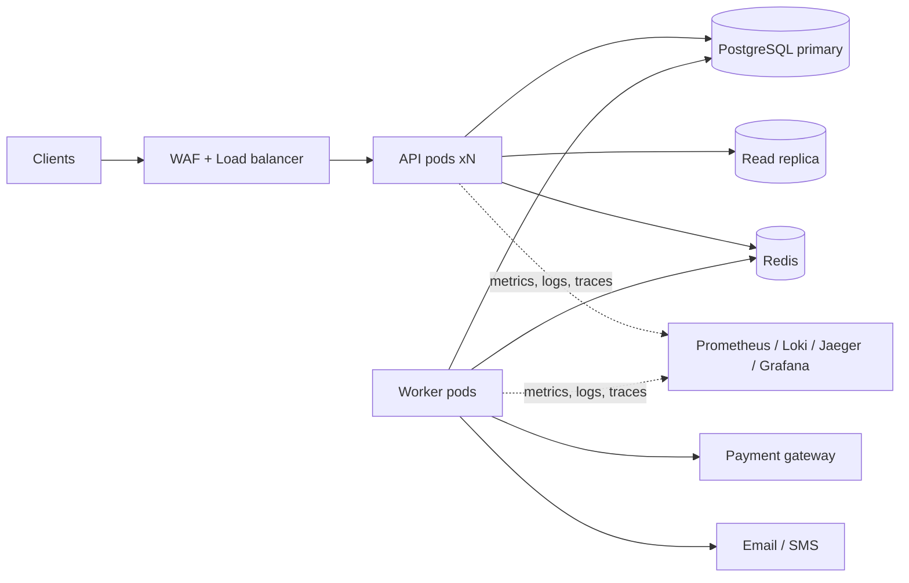

# Amrutam Telemedicine Backend

Production-grade backend for Amrutam's telemedicine platform: doctor discovery, slot booking with payments, consultation lifecycle, encrypted prescriptions, audit trails and admin analytics. Built for **100k consultations/day**, **p95 < 200 ms reads / < 500 ms writes**, **99.95 % availability**.

**Stack:** Node.js 20 · Express · TypeScript (strict) · PostgreSQL 16 · Redis 7 · BullMQ · REST + OpenAPI 3.1 · Docker · GitHub Actions · Kubernetes/Terraform · Prometheus/Grafana/OpenTelemetry

> 📘 The full design and implementation spec is in [`docs/IMPLEMENTATION_GUIDE.md`](docs/IMPLEMENTATION_GUIDE.md). This README covers setup and day-to-day usage.

---

## Contents

- [Features](#features)
- [Architecture at a glance](#architecture-at-a-glance)
- [Quick start](#quick-start)
- [Configuration](#configuration)
- [Running locally without Docker](#running-locally-without-docker)
- [API usage walkthrough](#api-usage-walkthrough)
- [Project structure](#project-structure)
- [Testing](#testing)
- [Security](#security)
- [Observability](#observability)
- [CI/CD and deployment](#cicd-and-deployment)
- [Backup and disaster recovery](#backup-and-disaster-recovery)
- [Documentation index](#documentation-index)
- [Troubleshooting](#troubleshooting)

---

## Features

| Area | Highlights |
|---|---|
| **Users & auth** | Patient / Doctor / Admin roles, argon2id, JWT key ring, rotating refresh tokens with reuse detection, TOTP MFA + backup codes (mandatory for doctors and admins), account lockout |
| **Doctors & search** | Verified-doctor onboarding, full-text + trigram search, filters (specialization, language, fee, rating, availability), keyset pagination, Redis cache-aside |
| **Availability & booking** | Bulk/recurring slots, DB-enforced no-overlap, **atomic slot hold** (no double booking), 10-minute payment hold |
| **Consultations** | State machine (pending payment → confirmed → in progress → completed / cancelled / expired / no-show), refund policy, saga with compensation |
| **Prescriptions** | Immutable versioned prescriptions, field-level AES-256-GCM encryption, async PDF generation |
| **Payments** | Gateway abstraction (mock included), signed webhooks, refunds, late-payment auto-refund |
| **Idempotency** | `Idempotency-Key` on all critical writes, race-free, stored in the same DB transaction |
| **Compliance** | Append-only, hash-chained, monthly-partitioned audit log with verification endpoint |
| **Admin** | Analytics overview / time series / top doctors, audit query, user and doctor management |
| **Ops** | Prometheus metrics, structured logs, distributed tracing, health probes, graceful shutdown |

## Architecture at a glance



* **Modular monolith** with strict module boundaries and DI (awilix); `api` and `worker` are separate processes from the same image.
* **Transactional outbox**: external calls (payment, email) never happen inside a request; workers drain the outbox, so writes stay fast and survive third-party outages.
* **Booking saga**: hold slot → create payment → confirm on webhook → compensate on failure/timeout.

See the guide §3, §6, §9 for diagrams (HLD, ER, booking sequence, state machine).

---

## Quick start

**Prerequisites:** Docker 24+ with Compose v2, Node.js 20 (only for running scripts/tests outside Docker), `make` optional.

```bash
git clone <your-repo-url> amrutam-backend && cd amrutam-backend
cp .env.example .env                      # review values; dev defaults work
npm run docker:up                         # builds, migrates, starts api + worker + infra
npm run seed                              # demo users, doctors, slots (in another terminal)
```

Then open:

| Service | URL |
|---|---|
| API | http://localhost:3000/api/v1 |
| Swagger UI | http://localhost:3000/docs |
| OpenAPI JSON | http://localhost:3000/openapi.json |
| Grafana (dashboards) | http://localhost:3001 |
| Prometheus | http://localhost:9090 |
| Jaeger (traces) | http://localhost:16686 |
| MailHog (emails) | http://localhost:8025 |

**Seeded demo accounts** (dev only; passwords are printed by the seed script):

| Role | Email |
|---|---|
| Admin | `admin@amrutam.test` |
| Doctor | `dr.sharma@amrutam.test`, `dr.iyer@amrutam.test` |
| Patient | `asha@example.com`, `ravi@example.com` |

Stop everything with `docker compose -f infra/docker/docker-compose.yml down` (add `-v` to wipe data).

## Configuration

All configuration is environment-variable based and validated at boot (the process exits on invalid config). Copy `.env.example` to `.env`.

| Variable | Purpose |
|---|---|
| `DATABASE_URL`, `DATABASE_READ_URL` | PostgreSQL primary / optional read replica |
| `REDIS_URL` | Cache, rate limiting, BullMQ |
| `JWT_KEYS`, `JWT_ACTIVE_KID` | JWT signing key ring (supports rotation) |
| `ENC_KEYS`, `ENC_ACTIVE_VERSION`, `KMS_KEY_ID` | Field-encryption keys (env in dev, KMS in prod) |
| `PAYMENT_PROVIDER`, `PAYMENT_WEBHOOK_SECRET` | Payment gateway (`mock` by default) |
| `RL_*` | Rate-limit thresholds |
| `SLOT_HOLD_MINUTES`, `CANCEL_FULL_REFUND_HOURS` | Business rules |
| `OTEL_EXPORTER_OTLP_ENDPOINT`, `METRICS_TOKEN` | Observability |

Generate secrets: `openssl rand -base64 32`. **Never commit `.env`.** In production, inject secrets from AWS Secrets Manager / Kubernetes Secrets. Full list: guide §5.

## Running locally without Docker

```bash
nvm use                         # Node 20 from .nvmrc
npm ci
docker compose -f infra/docker/docker-compose.yml up -d postgres redis
npm run migrate:up
npm run seed
npm run dev                     # API on :3000 (hot reload)
npm run dev:worker              # background jobs (separate terminal)
```

Create an admin (admins can't self-register): `npm run admin:create -- --email you@example.com`

---

## API usage walkthrough

Base path `/api/v1`. All errors use `application/problem+json`. Writes marked 🔁 in Swagger need an `Idempotency-Key` header. A complete reference with request and response bodies is in Swagger UI and guide §8.

```bash
BASE=http://localhost:3000/api/v1

# 1. Patient logs in
TOKEN=$(curl -s $BASE/auth/login -H 'content-type: application/json' \
  -d '{"email":"asha@example.com","password":"<seed password>"}' | jq -r .accessToken)

# 2. Search doctors
curl -s "$BASE/doctors?specialization=ayurveda&language=hi&sort=rating&limit=5" \
  -H "authorization: Bearer $TOKEN" | jq

# 3. See a doctor's open slots
curl -s "$BASE/doctors/<doctorId>/availability?from=2026-11-02&to=2026-11-09" \
  -H "authorization: Bearer $TOKEN" | jq

# 4. Book (idempotent: re-running with the same key returns the same result)
curl -s -X POST $BASE/consultations \
  -H "authorization: Bearer $TOKEN" -H 'content-type: application/json' \
  -H "Idempotency-Key: $(uuidgen)" \
  -d '{"slotId":"<slotId>","mode":"VIDEO","reason":"Recurring acidity"}' | jq

# 5. (dev only) simulate a successful payment
curl -s -X POST $BASE/dev/payments/<paymentId>/simulate \
  -H "authorization: Bearer $TOKEN" -H 'content-type: application/json' \
  -d '{"outcome":"succeeded"}'

# 6. Consultation is now CONFIRMED
curl -s $BASE/consultations/<consultationId> -H "authorization: Bearer $TOKEN" | jq .status
```

### Endpoint overview

| Area | Endpoints |
|---|---|
| Auth | `POST /auth/register`, `/auth/login`, `/auth/mfa/{setup,enable,verify,disable}`, `/auth/refresh`, `/auth/logout`, `/auth/logout-all`, `/auth/password/{change,forgot,reset}` |
| Users | `GET/PATCH /users/me`, `PUT /users/me/profile`, `DELETE /users/me`; admin: `GET /users`, `PATCH /users/{id}/{status,role}` |
| Doctors | `GET /doctors`, `GET /doctors/{id}`, `PUT /doctors/me`, `PATCH /admin/doctors/{id}/verification` |
| Availability | `POST/GET /doctors/me/slots`, `DELETE /doctors/me/slots/{id}`, `GET /doctors/{id}/availability` |
| Consultations | `POST /consultations` 🔁, `GET /consultations`, `GET /consultations/{id}`, `POST /consultations/{id}/{cancel,start,complete,no-show}` |
| Prescriptions | `POST/GET /consultations/{id}/prescriptions`, `GET /prescriptions/{id}` |
| Payments | `GET /payments/{id}`, `POST /payments/webhook`, `POST /payments/{id}/refund` 🔁 |
| Admin | `GET /admin/analytics/{overview,timeseries,top-doctors}`, `GET /admin/audit-logs`, `GET /admin/audit-logs/verify` |
| Ops | `GET /health/live`, `GET /health/ready`, `GET /metrics` |

---

## Project structure

```
src/
├── server.ts / worker.ts / app.ts / container.ts
├── config/            # zod-validated env
├── common/            # errors, middleware, crypto, db, cache, resilience, observability
├── modules/           # auth, users, doctors, availability, consultations, prescriptions,
│                      # payments, audit, analytics, idempotency, outbox, notifications, health
├── jobs/              # BullMQ queues, processors, scheduler
└── openapi/           # zod → OpenAPI registry
migrations/            # numbered SQL migrations (node-pg-migrate)
tests/                 # unit, integration, e2e, security, concurrency
infra/                 # docker, observability, k8s, terraform
docs/                  # guide, architecture, threat model, OpenAPI, runbooks, ADRs
scripts/               # seed, create-admin, generate-openapi, k6
```

Each module follows `routes → controller → service → repository (+ schemas)`. Controllers hold no logic, repositories hold no rules, and modules talk to each other only through services. Details: guide §4.

---

## Testing

```bash
npm test                    # unit tests
npm run test:integration    # real PostgreSQL + Redis via Testcontainers (Docker required)
npm run test:ci             # everything with coverage gates (what CI runs)
npm run test:load           # k6 load test (needs k6 installed and a seeded stack)
```

| Suite | What it proves |
|---|---|
| Unit | state machine, retry/backoff, encryption + key rotation, hash chain |
| Integration | every endpoint against real DB, constraints, outbox, workers |
| Concurrency | **50 parallel bookings of one slot → exactly one succeeds**; idempotency races |
| Security | RBAC matrix for every route, IDOR, injection payloads, rate limits, log redaction |
| Contract | responses match `docs/openapi.yaml` |
| E2E | register → verify doctor → book → pay → consult → prescribe → admin analytics |
| Load (k6) | p95 < 200 ms reads at 350 rps, p95 < 500 ms writes at 50 rps |

Coverage gate: ≥ 80 % overall, ≥ 90 % on auth, consultations, payments, idempotency and crypto.

Regenerate the API spec after changing routes: `npm run openapi:generate` (CI fails if `docs/openapi.yaml` is stale).

## Security

Implemented controls (full threat model, data classification and checklist in guide §14 and `docs/`):

* **AuthN/Z:** argon2id, lockout, MFA (TOTP + backup codes), short-lived JWTs, refresh rotation with reuse detection, RBAC **plus** per-record ownership checks (foreign records return 404).
* **Data protection:** TLS in transit; AES-256-GCM field-level encryption (versioned keys, AAD-bound) for clinical and personal data; documented key rotation with a `reencrypt` job; no PHI in logs, cache or traces.
* **API hardening:** helmet, CORS allow-list, strict zod validation, parameterised SQL only, rate limiting, body-size limits, generic 5xx responses.
* **Integrity:** idempotent writes, HMAC-signed webhooks with replay protection, DB constraints for every business invariant, append-only hash-chained audit log.
* **Supply chain:** `npm audit`, Trivy, gitleaks, CodeQL, Dependabot, pinned Actions, non-root read-only containers.

Report vulnerabilities privately to `security@<your-domain>`; do not open public issues.

## Observability

* **Metrics:** `/metrics` (Prometheus) with HTTP, DB, cache, booking, saga, queue, auth and security counters.
* **Logs:** JSON via pino with `requestId` / `traceId` correlation and PHI redaction.
* **Traces:** OpenTelemetry across API → outbox → worker.
* **SLOs and alerts:** 99.95 % availability with multi-window burn-rate alerts; latency, outbox-lag, DLQ, circuit-breaker and audit-chain alerts (`infra/observability/alerts.yml`).
* **Dashboards:** API overview, booking funnel, dependencies, workers, security (provisioned automatically in Grafana).

## CI/CD and deployment

**CI** (`.github/workflows/ci.yml`): lint → typecheck → OpenAPI drift + Spectral lint → tests with PostgreSQL/Redis services → `npm audit` + gitleaks → image build → Trivy scan. **CodeQL** runs on PRs and weekly.

**CD** (`deploy.yml`): `main` → staging → smoke test → manual approval → production rolling deploy with automatic rollback on failed readiness. Migrations run as a pre-deploy job using expand/contract so deploys are zero-downtime.

**Infrastructure as code:**

* `infra/docker/` — Dockerfile (multi-stage, non-root) and Compose stack
* `infra/k8s/` — Kustomize base/overlays: Deployments, HPA, PDB, NetworkPolicy, Ingress
* `infra/terraform/` — AWS reference: VPC, RDS Multi-AZ + replica, ElastiCache, ALB + WAF, KMS, Secrets Manager, S3 (Object Lock)

## Backup and disaster recovery

| | Target |
|---|---|
| RPO | ≤ 5 minutes (WAL archiving / PITR, Multi-AZ) |
| RTO | ≤ 2 min AZ failure, ≤ 30 min region failure |
| Backups | Daily snapshots, 35-day PITR, cross-region copies, WORM audit archive |
| Verification | Automated weekly restore test; quarterly DR game day |

Runbooks: `docs/runbooks/restore.md`, `failover.md`, `key-rotation.md`.

## Documentation index

| Document | Location |
|---|---|
| Implementation guide (full spec) | [`docs/IMPLEMENTATION_GUIDE.md`](docs/IMPLEMENTATION_GUIDE.md) |
| Architecture (2–4 pages) | `docs/architecture.md` |
| OpenAPI schema | `docs/openapi.yaml` (served at `/openapi.json`) |
| Threat model | `docs/threat-model.md` |
| Security checklist | `docs/security-checklist.md` |
| Runbooks | `docs/runbooks/` |
| Architecture decisions | `docs/adr/` |
| Load-test evidence | `docs/perf/` |

## Troubleshooting

| Symptom | Fix |
|---|---|
| API exits immediately with a config error | A required env var is missing or malformed; the log names it. Compare with `.env.example` |
| `ECONNREFUSED` to Postgres/Redis | Wait for health checks, or run `docker compose ps`; confirm ports 5432/6379 are free |
| `409 SLOT_UNAVAILABLE` on booking | Expected when the slot was taken or is held; pick another slot |
| `422 IDEMPOTENCY_KEY_REQUIRED` | Add an `Idempotency-Key` header (UUID) on 🔁 endpoints |
| Booking stuck in `PENDING_PAYMENT` | Payment not completed; in dev call `/dev/payments/{id}/simulate`. Unpaid bookings auto-expire after 10 minutes |
| Integration tests can't start | Testcontainers needs a running Docker daemon |
| `docs/openapi.yaml` diff fails CI | Run `npm run openapi:generate` and commit the result |

## License

Proprietary — assignment submission. Replace with your preferred license if open-sourcing.
