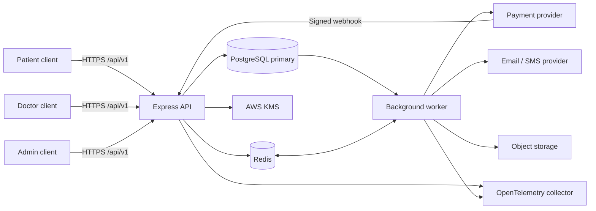

# Amrutam Telemedicine Backend Architecture

This document is the architecture overview for the repository. For local setup,
see the [root README](../README.md). Security controls and risks are covered by
the [security checklist](security-checklist.md) and [threat model](threat-model.md).
Detailed decisions are in [Design Docs](design.md), and cloud provisioning is
described in [Infrastructure as Code](infrastructure-as-code.md).

## Context and scope

The backend is a TypeScript modular monolith running on Node.js 20. It exposes a versioned REST API for patients, doctors, and administrators, with a separate worker process built from the same application. PostgreSQL is the source of truth for identity, clinician availability, consultations, payments, prescriptions, audit records, and asynchronous work. Redis supports rate limiting and BullMQ queues; business state is not dependent on Redis being available.

The repository includes application code, database migrations, local development infrastructure, Kubernetes manifests, Terraform reference modules, operational runbooks, and CI workflows. Provisioning production cloud resources, applying the infrastructure, capturing a live demonstration, and collecting production load or disaster-recovery evidence require external credentials and environments and are not performed by the source tree alone.

## System context

Clients authenticate with short-lived access tokens and rotating refresh tokens. Doctor and administrator accounts use MFA. Role checks and record ownership are enforced in the application, and sensitive fields are encrypted before persistence. The payment provider communicates asynchronously through a signed webhook; the API does not rely on a synchronous provider call to complete a booking.

The trust boundaries and principal data flows are also illustrated in the
[threat model](threat-model.md). This architecture document describes intended
system behavior; it is not evidence that production capacity, availability, or
recovery targets have been measured.

## Application structure

The API is composed in `src/app.ts` and started by `src/server.ts`. Feature modules own route factories, validation schemas, controllers, services, and repositories. Shared concerns live under `src/common` and include database pools, Redis, encryption, errors, authentication middleware, observability, and resilience utilities. The dependency container provides cross-cutting infrastructure such as the encryption service.

Routes are versioned beneath `/api/v1`. Request bodies, query parameters, and path parameters are validated at the boundary. Services enforce business rules and ownership; repositories perform parameterized database operations. A centralized error handler maps known application errors to stable problem responses while keeping internal details out of production responses. OpenAPI is generated from the route registry and schemas.

The worker entry point is `src/worker.ts`. It consumes typed BullMQ queues and dispatches jobs to processors in `src/jobs/processors`. API and worker processes share the same database, queue definitions, telemetry configuration, and shutdown behavior, but run independently so background work does not occupy API request capacity.

The application is intentionally kept as one deployable backend rather than a
set of independently deployed microservices. Domain modules expose service
interfaces and avoid reaching into each other's repositories. This keeps
transactional workflows local while leaving room to extract a module if
independent scaling or ownership needs emerge. The tradeoffs are recorded in
[ADR 0001](adr/0001-modular-monolith.md).

## Core booking and payment flow

1. The patient submits a consultation request with an idempotency key.
2. The API validates the request and opens a PostgreSQL transaction. It reserves the slot with a conditional update, checks for patient overlap, and creates the consultation, payment record, audit event, outbox event, and idempotent response atomically.
3. The worker relays committed outbox records to their target queues. The payment-intent processor calls the configured gateway with retries and idempotency, then records the resulting provider state.
4. The provider sends a timestamped HMAC-signed webhook. The API verifies the signature against the raw request body and applies the event transactionally with event deduplication. Payment, consultation, slot, audit, and follow-up event changes remain consistent.
5. Notifications and other secondary effects run asynchronously from the outbox. Repeated webhook delivery and retried jobs are safe through event and job deduplication.

The outbox table is the durable handoff between database transactions and workers. Redis loss can interrupt queue delivery but does not erase the business event; the relay can enqueue unpublished records again. Conditional writes, unique constraints, state-machine transitions, and serializable/locking operations protect concurrency-sensitive flows. Delivery is at least once, so processors and provider calls must remain idempotent. See [ADR 0002](adr/0002-outbox.md).

## Data and privacy boundaries

PostgreSQL stores relational business data and enforces constraints for unique identities, slot allocation, consultation state, and payment relationships. The primary pool handles writes and read-after-write operations; a separately configured read pool may serve suitable reads. Migrations follow an expand/migrate/contract approach to support rolling releases.

Redis holds ephemeral rate-limit and queue/cache state. Protected health information and profile data are not cached. Encryption uses AES-256-GCM with versioned keys. In AWS deployments, envelope encryption uses AWS KMS to wrap data keys; environment-provided keys support local development and migration reads. Associated data binds ciphertext to its owning table field and row. Key rotation and migration procedures are documented in the key-rotation runbook.

Audit records are append-only and hash chained. Database access, role checks, audit verification, and backups are part of the operational integrity boundary. Secrets are supplied through environment configuration locally and an external secret manager in cloud deployments; secret values must not be stored in source control.

## Reliability, scaling, and observability

The API is stateless and can scale horizontally behind a TLS-terminating ingress or load balancer. Database transactions are kept separate from network calls. Payment and notification work uses bounded retries and queue backoff; failed jobs are retained for inspection and dead-letter handling. Redis-dependent features have documented degraded modes, while PostgreSQL remains authoritative for booking decisions.

Liveness indicates that a process is running. Readiness also checks the dependencies required to serve traffic. SIGTERM initiates graceful shutdown, stops accepting work, drains active requests or jobs, and closes telemetry, queue, Redis, database, and encryption resources. Kubernetes manifests define availability, resource, and security settings; Terraform files provide an AWS-oriented deployment reference.

OpenTelemetry instrumentation exports traces and metrics. Prometheus rules and Grafana dashboards cover API behavior, dependency health, queue depth, outbox lag, and operational failures. The `/metrics` endpoint is restricted to authorized monitoring clients. Logs are structured and must not contain credentials, tokens, or PHI.

## Security and operations

Security controls include strict configuration validation, TLS and security headers at the edge, allow-listed CORS, request validation, per-IP and per-account rate limits, password hashing, token rotation and revocation, MFA, deny-by-default route metadata, ownership checks, encrypted sensitive fields, and signature verification for payment webhooks. Production documentation endpoints and development-only payment simulation are disabled in production.

The deployment reference uses private data subnets, managed PostgreSQL and Redis, KMS, secret management, network policies, non-root containers, and restricted workload permissions. CI runs linting, typechecking, tests, dependency checks, and image scanning. Deployment and infrastructure application still require a configured cloud account, credentials, and approval.

Database recovery, regional failover, key rotation, and failure handling are documented under [`runbooks/`](runbooks/). The intended objectives are RPO no greater than five minutes and RTO no greater than thirty minutes for regional loss. These are design targets, not verified production measurements: meeting them requires provisioning the secondary region and conducting scheduled restore and failover exercises.

## Repository map

| Area | Purpose |
|---|---|
| `src/modules/` | Domain routes, controllers, services, repositories, and schemas |
| `src/common/` | Shared database, cryptography, middleware, errors, and observability |
| `src/jobs/` | Queues, schedulers, and background processors |
| `migrations/` | Versioned PostgreSQL schema and constraint changes |
| `tests/` | Unit and integration coverage |
| `FRONTEND/` | Optional React/Vite client for local workflows |
| `infra/docker/` | Local development stack |
| `infra/k8s/` | Kubernetes manifests and environment overlays |
| `infra/terraform/` | AWS ECS reference infrastructure |
| `docs/` | Architecture, design, security, API, and operational documentation |

## Related documentation

- [Design Docs](design.md) and [architecture decision records](adr/)
- [Infrastructure as Code](infrastructure-as-code.md)
- [Security checklist](security-checklist.md)
- [Threat model](threat-model.md)
- [Implementation guide](IMPLEMENTATION_GUIDE.md)
- [OpenAPI specification and generated request schemas](openapi.yaml)
- [Operational runbooks](runbooks/)

## Key architectural decisions

| Decision | Rationale |
|---|---|
| Modular monolith with separate worker process | Keeps domain boundaries clear while avoiding premature service-to-service consistency costs. |
| PostgreSQL as the business and outbox source of truth | Makes booking, payment-state, audit, and work publication changes transactional. |
| Redis/BullMQ for asynchronous execution | Provides concurrency and retries while allowing queue state to be rebuilt from the outbox. |
| Idempotency at request, webhook, and job boundaries | Makes client retries and at-least-once delivery safe. |
| Envelope encryption with versioned keys | Supports field-level PHI protection and controlled key rotation. |
| Explicit external deployment evidence | Cloud provisioning, measured SLOs, load tests, and DR exercises cannot be truthfully claimed without the target environment. |