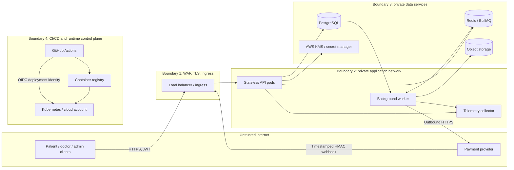

# Threat Model

## Scope and method

This STRIDE review covers the patient/doctor/admin REST API, the payment webhook, the asynchronous worker, PostgreSQL, Redis, KMS/secret storage, object storage, and the CI-to-deployment path. It is a design document, not a penetration-test report or a compliance certification. Revisit it when data flows, providers, trust boundaries, or deployment topology change.

## Data-flow and trust boundaries

Trust boundaries:

1. Internet clients and payment provider to the TLS-terminating edge.
2. Edge to application workloads.
3. API/worker to private database, queue, key, and object-storage services.
4. Worker egress to payment and notification providers.
5. CI identity and build artifacts to the registry and deployment control plane.

## Assets and threat actors

**Assets:** protected health information (consultation reason, doctor notes, prescription), profile data, passwords and MFA secrets, access/refresh tokens, payment state, availability and booking integrity, audit history, encryption keys, and service availability.

**Actors:** unauthenticated internet attacker; malicious patient or clinician; compromised administrator account; insider with database or cloud access; compromised payment/notification provider; malicious dependency or CI credential.

## STRIDE analysis

| ID | Threat | Primary controls | Residual risk / verification |
|---|---|---|---|
| S1 | Credential stuffing or account enumeration | Argon2id, generic credential errors, per-IP and per-account throttling, lockout, MFA for privileged roles | Validate configured limits and alert thresholds in the deployed environment. |
| S2 | Stolen or replayed refresh token | Hashed refresh-token storage, token-family rotation and reuse detection, session revocation | Confirm revocation/cache behavior across multiple API replicas. |
| S3 | Forged payment webhook | Raw-body HMAC verification, bounded timestamp window, timing-safe comparison, event deduplication | Provider IP allow-list and key rotation must be configured at the edge/provider. |
| T1 | IDOR or unauthorized PHI access | Authentication, role/ownership checks in services, UUID validation, deny-by-default route metadata | Run a full role × route matrix against a migrated database before release. |
| T2 | Concurrent booking or client-supplied price tampering | Conditional slot hold, database constraints, transaction, server-side fee lookup, idempotency | Run the concurrency suite against PostgreSQL; do not rely on Redis for booking correctness. |
| T3 | Audit-log alteration | Append-only database protections, hash-chain verification, audited actions | A database superuser can bypass application controls; archive verified partitions to immutable storage. |
| T4 | Replayed writes or duplicate payment events | Idempotency records, webhook event IDs, transaction boundaries, BullMQ job IDs | At-least-once delivery can still repeat side effects; every processor/provider call must remain idempotent. |
| R1 | Actor disputes a clinical or administrative action | Actor and request identifiers in audit events; immutable, versioned prescription records | Ensure all sensitive reads and writes emit audit records; test archive verification. |
| I1 | PHI disclosure through database theft | AES-256-GCM field encryption, versioned/envelope keys, KMS separation | KMS and key access policy are deployment responsibilities; test backup restoration and key recovery. |
| I2 | PHI in logs, cache, traces, URLs, or errors | Structured logs, field redaction, no-PHI cache policy, generic production 5xx responses | Add automated log-redaction checks and review telemetry providers before enabling production traces. |
| I3 | SQL injection or unsafe filters | Parameterized SQL, strict Zod validation, bounded pagination and search inputs | Keep code review and dependency/static analysis gates enabled. |
| I4 | User enumeration through login/reset flows | Generic responses and comparable password verification work | Verify response behavior and rate limits with black-box tests. |
| D1 | API flood, expensive searches, or oversized payloads | Global and endpoint rate limits, body-size bounds, query limits, database statement timeouts | WAF, connection limits, autoscaling, and load-shedding thresholds require deployment configuration. |
| D2 | Slot hoarding or queue retry storm | Slot-hold expiry, booking limits, worker retry/backoff, dead-letter queues | Confirm expiry scheduling and alert on old holds, queue depth, and outbox lag. |
| D3 | Redis failure interrupts queue/cache functions | PostgreSQL outbox is the durable event source; local limiter fallback | Rate-limit fallback is per-process; Redis recovery and outbox replay need an operational drill. |
| E1 | Role escalation or forged tokens | Role is not client-settable, pinned JWT algorithm, key ID allow-list, MFA, step-up for sensitive actions | Protect signing keys and review role changes through audited operator procedures. |
| E2 | Compromised dependency or CI identity | Lockfile, dependency audit, Dependabot, CodeQL, image scan, OIDC-based deployment | Pin third-party Actions by immutable SHA and enforce branch protection/review in repository settings. |
| E3 | Container escape or lateral movement | Non-root, read-only root filesystem, dropped capabilities, resource limits, Kubernetes NetworkPolicy | Validate the rendered manifests and cloud network policy after applying overlays. |

## Assumptions and response

- Production traffic is TLS-only; PostgreSQL and Redis are private and authenticated.
- Secrets are injected from an approved secret manager and are not baked into images or committed.
- Only the payment provider may reach the webhook endpoint at the edge, while application signature validation remains mandatory.
- Access to KMS, object storage, clusters, and database administration is least-privilege and audited.
- Suspected PHI exposure triggers the incident process, access/key containment, evidence preservation, privacy/legal assessment, and notification according to applicable law and contracts.

Before production, review this model with the service owner, complete the security checklist, test authorization and log redaction, and exercise restore and key-rotation procedures.